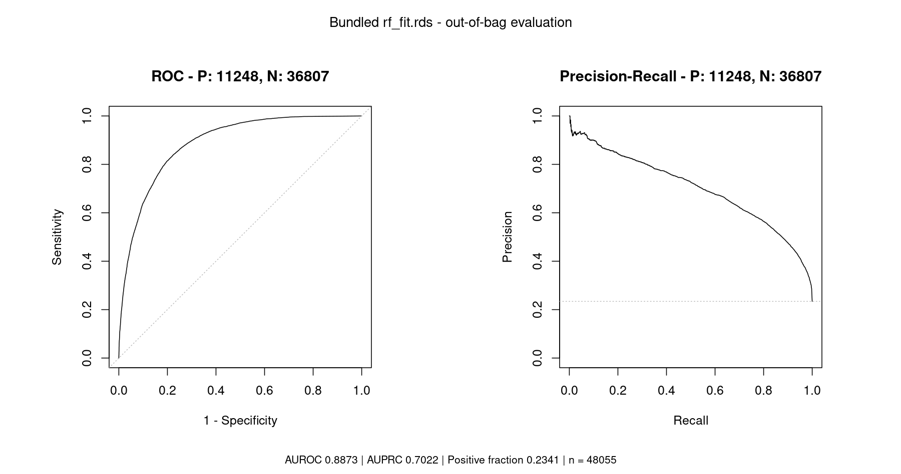

# m6APrediction

An R package for predicting candidate N6-methyladenosine (m6A) sites from sequence context and site-level features using a fitted random forest classifier. Developed by Yiming Huang for BIO215.

The package provides single-site and batch prediction functions, a course-supplied fitted model, and a 100-row example feature table.

## Installation

R >= 3.5.0 is declared in the package metadata. Dependencies may require a newer R version. The package was checked on the teaching server using R 4.5.1.


```r
install.packages("remotes")
remotes::install_github("student-huang2024/m6APrediction")
library(m6APrediction)
```

## Batch prediction

This example reads the bundled model and feature table, then predicts the first three sites.

```r
library(m6APrediction)

ml_fit <- readRDS(system.file(
  "extdata", "rf_fit.rds",
  package = "m6APrediction", mustWork = TRUE
))
features <- read.csv(system.file(
  "extdata", "m6A_input_example.csv",
  package = "m6APrediction", mustWork = TRUE
))

result <- prediction_multiple(
  ml_fit, head(features, 3), positive_threshold = 0.6
)
result[, c("predicted_m6A_prob", "predicted_m6A_status")]
```

The returned data frame includes the input columns, a numeric score named `predicted_m6A_prob`, and a character label named `predicted_m6A_status`.

## Single-site prediction

This example independently loads its model and supplies all seven input features.

```r
library(m6APrediction)

ml_fit <- readRDS(system.file(
  "extdata", "rf_fit.rds",
  package = "m6APrediction", mustWork = TRUE
))

prediction_single(
  ml_fit,
  gc_content = 0.6,
  RNA_type = "mRNA",
  RNA_region = "CDS",
  exon_length = 12,
  distance_to_junction = 5,
  evolutionary_conservation = 0.8,
  DNA_5mer = "GGACA",
  positive_threshold = 0.5
)
```

The result is a named character vector containing `predicted_m6A_prob` and `predicted_m6A_status`. Convert the score with `as.numeric()` when a numeric value is needed.

## Input features

| Column | Meaning and expected values |
| --- | --- |
| `gc_content` | Numeric GC fraction. |
| `RNA_type` | `mRNA`, `lincRNA`, `lncRNA`, or `pseudogene`. |
| `RNA_region` | `CDS`, `intron`, `3'UTR`, or `5'UTR`. |
| `exon_length` | Exon length on the course log2-transformed scale. |
| `distance_to_junction` | Junction distance on the course log2-transformed scale. |
| `evolutionary_conservation` | Numeric conservation score using the course feature definition. |
| `DNA_5mer` | Five uppercase DNA bases from A, T, C, and G, with A at the central position. |

Prepare complete rows with valid categories before prediction. The internal `dna_encoding()` helper represents each nucleotide position as a categorical factor.

A site is labelled Positive when its score is strictly greater than `positive_threshold`. Scores equal to the threshold are labelled Negative.

The bundled feature table supports software demonstrations. Assessment of biological prediction performance requires labelled evaluation data and a documented evaluation procedure.

## Bundled model evaluation

The bundled random forest was evaluated using its stored out-of-bag (OOB) votes for 48,055 training observations. For each observation, OOB votes come from trees whose bootstrap training samples excluded that observation.



| Metric | OOB result |
| --- | --- |
| AUROC | 0.8873 |
| AUPRC | 0.7022 |
| Evaluated observations | 48,055 |
| Positive fraction | 0.2341 |

ROC describes sensitivity against false-positive rate. PRC describes precision against recall. These results support the use of the course features to prioritize candidate m6A sites. These are internal OOB estimates; independent validation is needed to assess performance in new biological datasets.

The following metrics use the same OOB predictions and the package rule that a score must be strictly greater than the threshold to be labelled Positive.

| Threshold | Accuracy | Precision | Recall | False-positive rate |
| --- | --- | --- | --- | --- |
| 0.5 | 0.8389 | 0.6967 | 0.5522 | 0.0735 |
| 0.6 | 0.8351 | 0.7475 | 0.4464 | 0.0461 |

Increasing the threshold from 0.5 to 0.6 increases precision and reduces the false-positive rate, while recovering a smaller fraction of positive sites.

Source: the bundled model's stored OOB votes, evaluated with precrec by check_rf_model.R on the teaching server.

## Help and software checks

```r
?prediction_single
?prediction_multiple
```

Version 1.0.0 passed the following check on the teaching server with 0 errors, 0 warnings, and 0 notes before README preparation.

```r
devtools::check(args = "--no-manual", cran = FALSE)
```

## Author and license

Yiming Huang  
Yiming.Huang2403@student.xjtlu.edu.cn

MIT license. See `LICENSE` for the copyright holder.
